# 🚀 微光校园互助 - 校园互助服务平台

> 本项目基于开源项目 **福U跑腿（fuu-run）** 二次开发，改造为面向校园场景的互助服务平台，仅用于毕业设计、学习交流目的。

```
⚠️⚠️⚠️注意：本项目为二次开发版本，原项目版权归原作者所有，fork、转载或二次开发请注明原作者⚠️⚠️⚠️
```

---

## 📢 项目声明

- 本项目仅用于学习交流与毕业设计用途，不在任何平台出售，如有发现请积极举报
- 本项目是一个全栈项目，包含完整的前后端实现
- 如果本项目对您有所帮助，欢迎给个 ⭐ Star 支持


## 📚 技术栈

### 后端技术栈
| 技术 | 说明 | 版本 | 官网 |
| --- | --- | --- | --- |
| Spring Boot | 容器+MVC框架 | 2.7.6 | [https://spring.io/projects/spring-boot](https://spring.io/projects/spring-boot) |
| Sa-Token | 权限认证框架 | 1.37.0 | [https://sa-token.dev33.cn](https://sa-token.dev33.cn) |
| MyBatis-Plus | ORM框架 | 3.5.4 | [https://mybatis.org](https://mybatis.org) |
| Redis | 分布式缓存 | 最新 | [https://redis.io](https://redis.io) |
| MySQL | 关系型数据库 | 8.0 | [https://www.mysql.com](https://www.mysql.com) |
| Redisson | 分布式锁 / 延迟队列 | 3.20.1 | [https://redisson.org](https://redisson.org) |
| Netty | 网络应用框架（WebSocket） | 4.1.36.Final | [https://netty.io](https://netty.io) |
| Undertow | Web 容器 | 随 Spring Boot | [https://undertow.io](https://undertow.io) |

### 前端技术栈

| 技术 | 说明 | 版本 | 官网 |
| --- | --- | --- | --- |
| 小程序端 | | | |
| Vue | 前端框架 | 3.x | [https://vuejs.org](https://vuejs.org) |
| Uni-app | 跨平台框架 | 3.x | [https://uniapp.dcloud.io](https://uniapp.dcloud.io) |
| NutUI-Uniapp | 移动端组件库 | 1.8.x | [https://nutui-uniapp.netlify.app](https://nutui-uniapp.netlify.app) |
| 管理后台 | | | |
| React | 前端框架 | 18.2 | [https://react.dev](https://react.dev) |
| Ant Design Pro | 中后台 UI 框架 | 5.x | [https://pro.ant.design](https://pro.ant.design) |


## 🎯 项目简介

微光校园互助是一款专注于校园场景的综合性互助服务平台，采用前后端分离架构，基于 Spring Boot + Vue/Uni-app + React 开发。本项目致力于解决校园内快递代取、餐食代购、学习互助等日常需求，让有能力、有余力的同学可以就近接单，为校园师生提供便捷、安全、高效的互助服务。

> 业务语义上，"任务"即原项目中的"订单"，"互助员"即原项目中的"跑腿员"。


### 项目结构

```
微光校园互助/
├── docImgs/                   # 系统图例展示
│
├── wg-campus/                 # 后端服务
│   ├── wg-admin/              # 服务入口模块（Controller 层）
│   ├── wg-common/             # 通用工具模块
│   ├── wg-framework/          # 框架核心模块
│   ├── wg-order/              # 互助订单模块
│   ├── wg-oss/                # OSS 管理模块
│   ├── wg-payment/            # 支付模块
│   ├── wg-system/             # 系统管理模块
│   └── pom.xml                # 父 pom 文件
│
├── wg-campus-admin/           # 管理端前端 (Ant Design Pro / React)
│   ├── config/                # 配置文件
│   ├── public/                # 静态资源
│   ├── src/                   # 源代码
│   └── ...                    # 其他配置文件
│
├── wg-campus-uni/             # 小程序端 (Uni-app)
│   ├── common/                # 公共模块
│   ├── pages/                 # 页面目录
│   ├── static/                # 静态文件
│   └── ...                    # 其他配置文件
│
└── init.sql                   # 数据库初始化脚本
```


### 核心功能

##### **🔴用户服务**

- **多角色系统**：管理员、校区代理、互助员、普通用户
- **校区选择**：支持多校区切换，按校区展示任务
- **地址管理**：支持快捷选址、地图选点
- **申请互助**：审核通过后可在线接单
- **发布任务**：支持帮取送、代买、万能服务三类任务，可填写任务标题、任务描述、悬赏金额、截止时间与任务地点
- **任务大厅**：按校区浏览待接任务
- **订单申诉**：对异议订单申诉通过可全额退款
- **实时沟通**：订单内可与互助员、管理员在线沟通
- **敏感词检测**：对编辑内容进行敏感词检测
- **微信订阅消息**：订单状态、消息通知、退款状态变更时在微信内通知用户

##### **🟠订单系统**

- **订单自动化机制**：长时间未付款、未接单自动取消，长时间未确认自动完成订单
- **订单全生命周期管理**

##### **🟡支付系统**

- **集成微信支付**
- **悬赏金额追加**：可追加悬赏金额提高接单几率
- **余额提现功能**
- **资金流动记录**

##### **🟢运营管理**

- **多校区统一管理**
- **系统管理**：系统监控、轮播图管理、全局配置
- **区域管理**（用于快捷地址）
- **用户、权限管理**
- **工单处理**：互助申请管理、订单申诉管理
- **邮箱通知**：有新工单时会邮箱通知
- **标签管理**（快捷选择任务标题）
- **OSS 对象存储管理**
- **资金管理**：余额管理、提现申请、资金流动、账户明细

### 技术亮点

##### 🔴**模块化架构设计**

- 基于 Spring Boot 的多模块开发，采用父子 POM 结构
- 模块间低耦合高内聚，便于维护和扩展
- 统一的依赖管理和版本控制
- 模块化的业务划分，包括订单、支付、系统管理等核心模块

##### 🟠**高并发**

- 基于 Redisson 实现分布式锁，保证订单接单等关键操作的并发安全
- Redis 队列实现异步任务处理机制：
  - 支付和退款回调的异步处理
  - 订单超时自动取消机制
  - 订单自动完成处理
- 基于 Redisson 对 Redis 队列进行封装，降低编码维护成本，提高可用性

##### **🟡安全性与权限控制**

- 基于 Sa-Token 实现 RBAC 权限控制系统
- 基于 AOP、自定义注解和 Redis 实现接口限流
- 全局异常处理，统一异常响应

##### 🟢**实时通信**

- 基于 Netty 实现 WebSocket 服务，支持超高并发
- 用户聊天消息异步持久化处理

##### **🟣数据验证与安全处理**

- 自定义注解与 Validator 实现字段校验
- 整合 SensitiveWord 实现敏感词过滤
- 数据字段防止 XSS 攻击

## 🎯 项目展示（仅展示部分，其他在 docImgs 里查看）

### 小程序端界面

<table>
<tr>
    <td>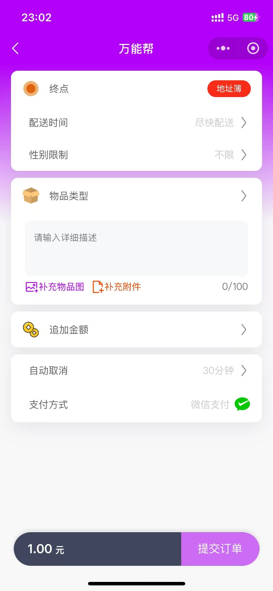</td>
    <td>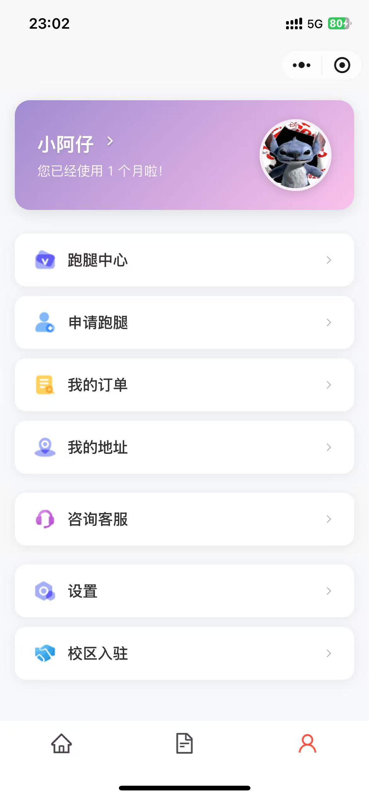</td>
    <td>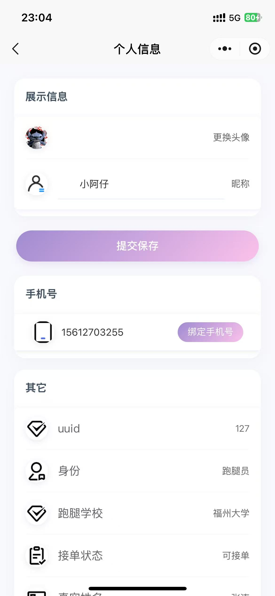</td>
</tr>
<tr>
    <td>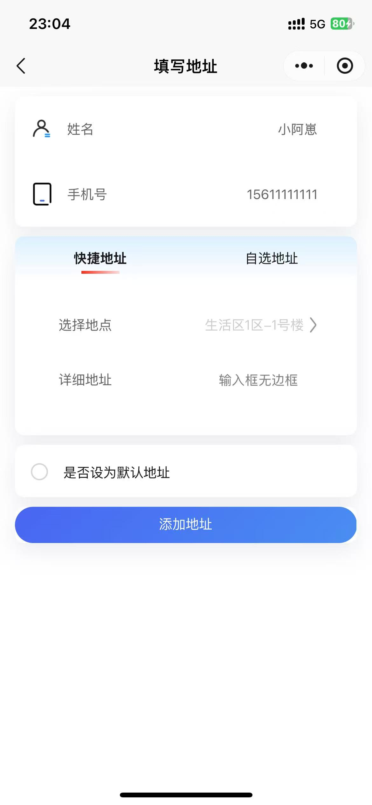</td>
    <td>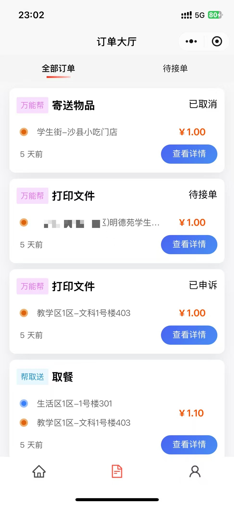</td>
    <td>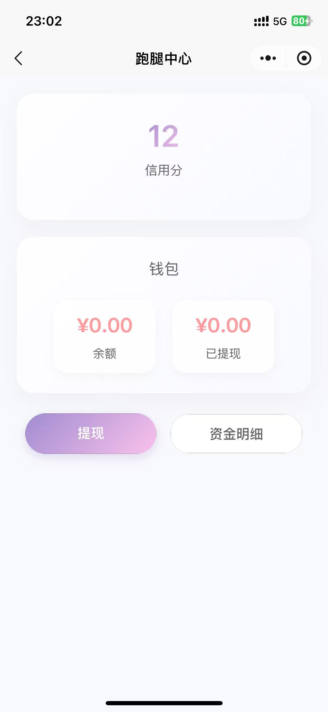</td>
</tr>
<tr>
    <td>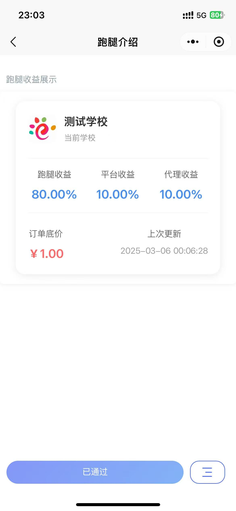</td>
    <td>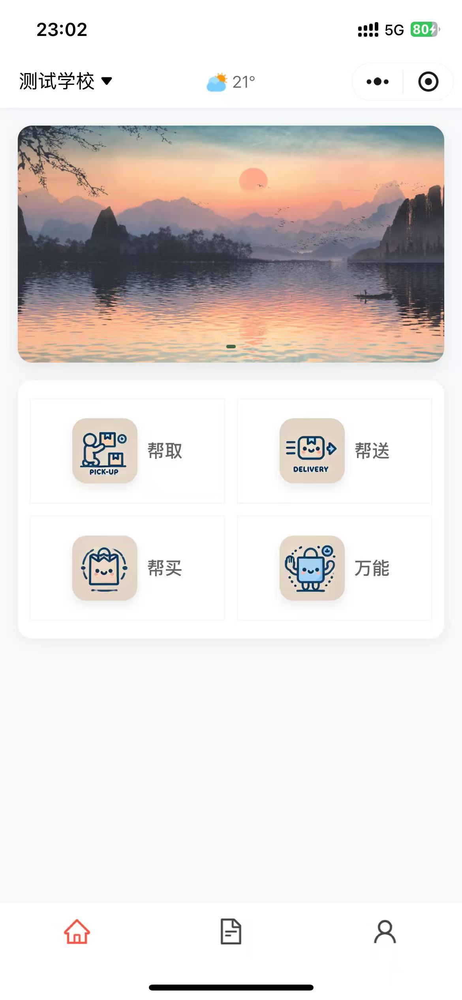</td>
    <td></td>
</tr>
</table>


### 管理后台界面
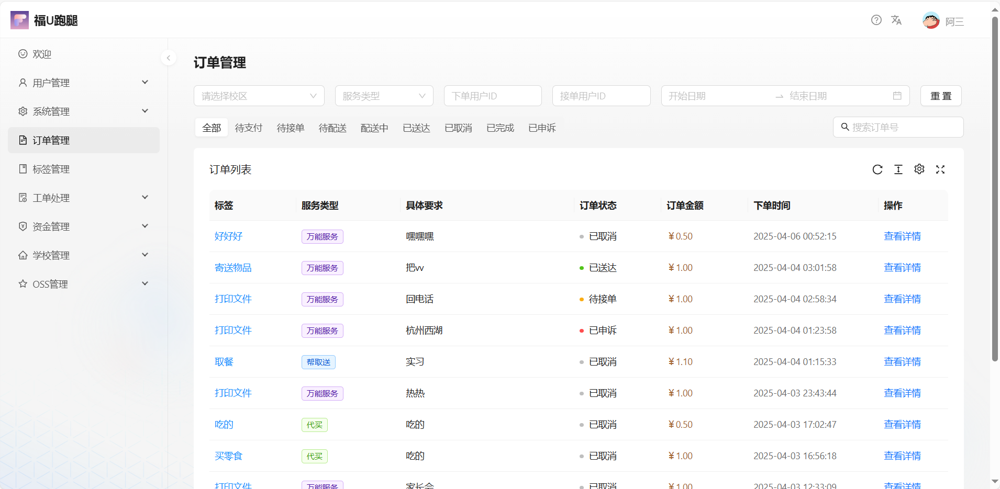

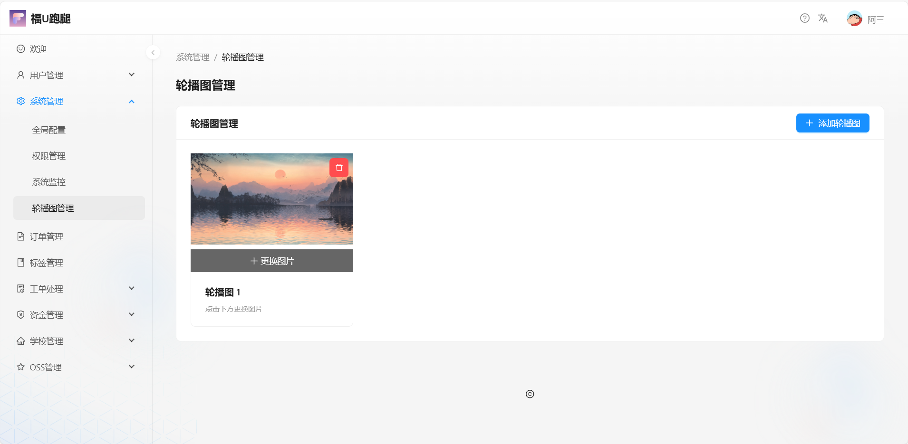

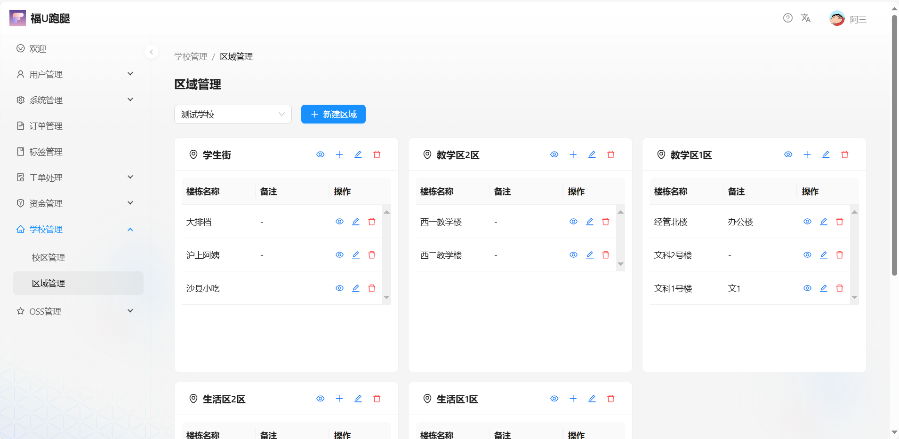


## 🚀 快速开始

### 准备工作

- [申请高德地图 API Key](https://console.amap.com/dev/key/app)
- [申请微信小程序](https://mp.weixin.qq.com/wxopen/waregister?action=step1)（个体户/公司）
- [小程序认证](https://mp.weixin.qq.com/wxopen/verification?action=index&t=wx_verify/index&lang=zh_CN)（个体户 30￥）
- [开通微信支付](https://pay.weixin.qq.com/index.php/apply/applyment_home/guide_normal)
- [购买 OSS 对象存储](https://www.aliyun.com/product/oss)（建议阿里云 OSS）

### 后端部署

#### 环境要求
- JDK 1.8+
- Spring Boot 2.7.6
- MySQL 8.X
- Redis

#### 配置步骤
1. 克隆项目到本地
2. 创建数据库 `campus_mutual_aid`
3. 执行 `init.sql` 初始化数据库
4. 配置 `wg-campus/wg-admin/src/main/resources/application.yml`：
   - 高德地图 API Key
   - 微信小程序配置
   - 微信支付配置
   - OSS 存储配置
5. 导入支付密钥文件至 `wg-campus/wg-admin/src/main/resources/cert/` 目录
   （需包含 `apiclient_key.pem` 与 `apiclient_cert.pem`）
6. 构建并运行项目

### 前端部署

#### 小程序端
- 环境要求：
  - Node.js 16.13.1
  - npm 8.1.2

- 开发工具：
  - HBuilder X
  - 微信开发者工具

- 部署步骤：
  1. 使用 HBuilder X 打开 `wg-campus-uni`
  2. 配置微信小程序 AppID（`manifest.json`）
  3. 安装依赖：`npm install`
  4. 运行到微信开发者工具

#### 管理后台
- 环境要求：
  - Node.js 16.13.1
  - npm 8.1.2

- 开发工具：VSCode
- 部署步骤：
  1. 打开 `wg-campus-admin`
  2. 安装依赖：`npm install`
  3. 启动开发服务器：`npm run start:dev`

## 🙏 特别鸣谢

- **[福U跑腿（fuu-run）](https://gitee.com/Karrecy/fuu-run)** - 本项目基于该项目二次开发，感谢原作者的开源贡献
- [Ant Design Pro](https://pro.ant.design/) - 开箱即用的中台前端/设计解决方案
- [RuoYi-Vue](https://gitee.com/y_project/RuoYi-Vue) - 基于 SpringBoot 的权限管理系统
- [SensitiveWord](https://github.com/houbb/sensitive-word) - 基于 DFA 算法的敏感词过滤工具
- [Sa-Token](https://sa-token.dev33.cn/) - 轻量级 Java 权限认证框架
- [NutUI-Uniapp](https://nutui-uniapp.netlify.app) - 京东风格的 Uni-app 移动端组件库

---

<div align="center">
感谢您的使用！如果觉得项目不错，请给个 ⭐ Star 支持！
</div>
